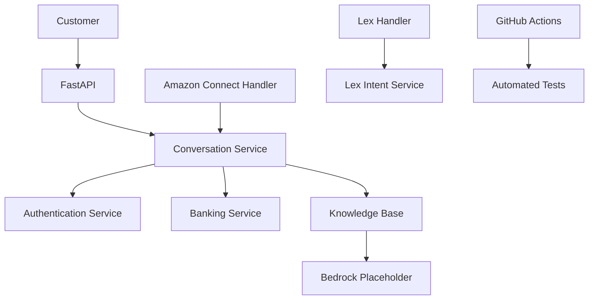

# Banking Virtual Assistant using Amazon Connect


## About

This project is a Python-based banking virtual assistant. It handles common customer questions such as account balance, recent transactions, account information, and general banking queries.

The application is organized into separate Python services for banking operations, authentication, conversation handling, and customer interaction. It also includes sample handlers for Amazon Connect and Amazon Lex V2.

## Features

- Account balance inquiries using sample customer records.
- Recent transaction history.
- Basic account information lookup.
- Demo OTP generation and verification.
- Keyword-based intent detection for common banking requests.
- Banking FAQ responses using a local knowledge base.
- FastAPI endpoints for health checks and chat requests.
- Sample Amazon Connect and Amazon Lex event handlers.
- Automated tests using pytest and GitHub Actions.

## Technologies

- Python
- FastAPI
- Amazon Connect
- Amazon Lex V2
- Amazon Bedrock (planned integration)
- AWS Lambda
- pytest
- GitHub Actions
- Git and GitHub

## Project Structure

```text
amazon-connect-generative-ai-banking-assistant/
│
├── app/
│   ├── services/
│   │   ├── __init__.py
│   │   ├── authentication_service.py
│   │   ├── banking_service.py
│   │   ├── bedrock_service.py
│   │   ├── connect_service.py
│   │   ├── conversation_service.py
│   │   ├── knowledge_base.py
│   │   └── lex_service.py
│   │
│   ├── __init__.py
│   └── api.py
│
├── lambda/
│   ├── __init__.py
│   ├── connect_handler.py
│   └── lex_handler.py
│
├── tests/
│   ├── test_authentication_service.py
│   ├── test_banking_service.py
│   ├── test_conversation_service.py
│   ├── test_banking_service.py
│   └── test_api.py
│
├── .github/
│   └── workflows/
│       └── tests.yml
│
├── main.py
├── requirements.txt
├── README.md
└── LICENSE
```

## Application Architecture

The application is organized into separate services:

- **Conversation Service:** Handles customer messages and manages the conversation flow.
- **Banking Service:** Provides sample account details, balance information, and transaction history.
- **Authentication Service:** Generates and verifies demo OTPs.
- **Knowledge Base:** Stores common banking questions and answers.
- **Bedrock Service:** Performs local FAQ matching as a placeholder for future Bedrock integration.
- **Connect Service:** Handles sample contact events and chat messages.
- **Lex Service:** Identifies common banking intents using keyword matching.
- **Lambda Handlers:** Provide example entry points for Connect and Lex-style events.

### Architecture Diagram



## How the Application Works

A customer submits a banking-related question through the application.

The conversation service processes the message and identifies the request. For account-related questions, it uses the banking service to retrieve information from sample customer records.

The authentication service contains a basic OTP generation and verification flow. General banking questions are matched against the local knowledge base.

The Connect and Lex handler files provide sample entry points for processing contact and intent events.

The current Bedrock service uses local FAQ matching. It does not make live Amazon Bedrock API calls.

## API Usage

The project includes a FastAPI interface for sending banking questions.

### Available Endpoints

| Method | Endpoint | Description |
|---|---|---|
| GET | `/health` | Checks whether the API is running |
| POST | `/chat` | Accepts a customer message and returns an assistant response |

### API Documentation

FastAPI provides interactive API documentation when the application is running.

```text
http://127.0.0.1:8000/docs
```

## Running Locally

Install the project dependencies:

```bash
pip install -r requirements.txt
```

Start the FastAPI application:

```bash
uvicorn app.api:app --reload
```

Open the API documentation in your browser:

```text
http://127.0.0.1:8000/docs
```

The command-line assistant can also be started using:

```bash
python main.py
```

## Testing

The project uses pytest for automated testing.

Run the tests using:

```bash
pytest -v
```

GitHub Actions runs the automated test suite whenever changes are pushed to the main branch.

## Current Scope and Limitations

- Uses sample banking data and does not connect to real customer accounts.
- OTP verification is a basic demonstration and is not production-grade authentication.
- The Bedrock service currently performs local FAQ matching instead of calling an AWS model.
- Amazon Connect and Lex handlers are sample implementations and have not been connected to live AWS resources.
- No actual banking transactions are processed.

## Future Improvements

- Integrate Amazon Bedrock for AI-generated banking responses.
- Configure Amazon Lex V2 intents and fulfillment.
- Connect Amazon Connect contact flows with AWS Lambda.
- Add secure authentication and session management.
- Expand automated testing and error handling.
- Add a retrieval-based knowledge system for banking FAQs.
